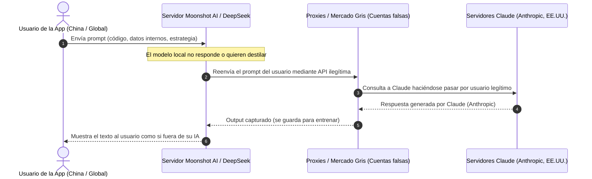
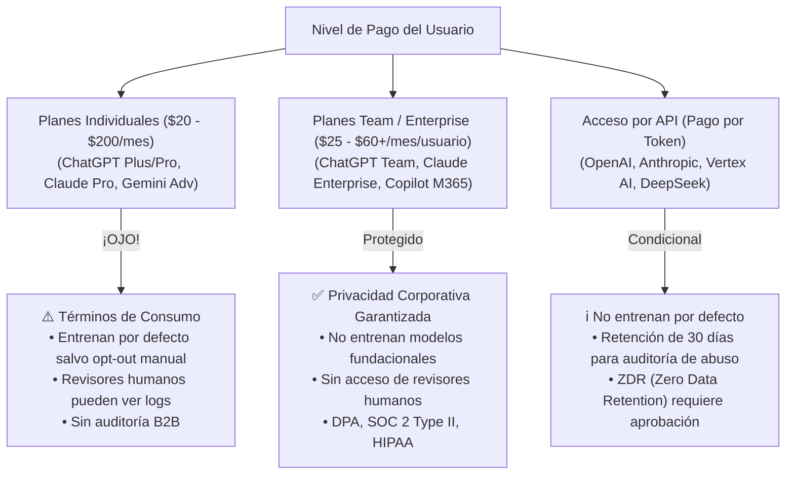
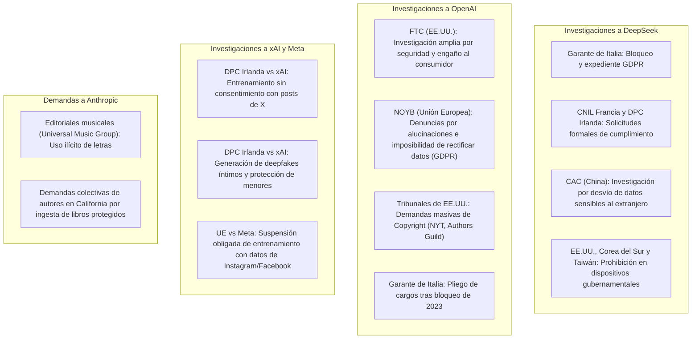

# Dossier de Investigación: Denuncia de Anthropic, DeepSeek, Ruteo Oculto de Prompts y el Panorama Global de Privacidad en IA

**Fecha de elaboración:** Octubre 2026  
**Contexto:** Preparación y referencia analítica para la adopción de Inteligencia Artificial Local vs. Servicios en la Nube.

---

## 1. Resumen Ejecutivo

En 2026, el ecosistema de la inteligencia artificial generativa ha entrado en una fase crítica marcada por acusaciones de espionaje tecnológico, parasitismo de modelos ("illicit distillation"), ruteo encubierto de consultas de usuarios y una ola sin precedentes de investigaciones regulatorias en Estados Unidos, la Unión Europea y la propia China.

1. **La Denuncia de Anthropic (Febrero y Septiembre de 2026):**  
   Anthropic publicó investigaciones detalladas revelando que laboratorios chinos de primer nivel —destacando **DeepSeek, Moonshot AI, MiniMax y Alibaba**— desplegaron campañas a escala industrial utilizando decenas de miles de cuentas fraudulentas y cientos de millones de interacciones para extraer ("destilar") capacidades de razonamiento, código y cadenas de pensamiento (*Chain-of-Thought*) de **Claude**.
2. **El Escándalo del Ruteo Oculto de Prompts:**  
   Uno de los hallazgos más graves del informe de Anthropic reveló que empresas como **Moonshot AI redirigían silenciosamente las consultas de sus propios usuarios directamente a la API de Claude de Anthropic**, presentando las respuestas obtenidas como si procedieran de su propio modelo de IA.
3. **La Investigación de los Reguladores Chinos (CAC):**  
   Lejos de celebrar el éxito de sus laboratorios locales, la **Administración del Ciberespacio de China (CAC)** abrió inspecciones formales e interrogatorios contra **DeepSeek y Moonshot AI**. El motivo no es defender la propiedad intelectual de EE.UU., sino la **seguridad nacional china**: al desviar masivamente prompts de usuarios locales hacia servidores estadounidenses de Anthropic, se expuso potencialmente información sensible corporativa, militar y gubernamental china a territorio norteamericano.
4. **La Alerta de Seguridad Nacional de EE.UU. (NSA, CISA, FBI):**  
   En septiembre de 2026, las agencias de inteligencia de EE.UU. publicaron una alerta conjunta confirmando que empresas chinas como DeepSeek y Alibaba atacaban sistemáticamente los modelos frontera occidentales mediante destilación no autorizada.
5. **Privacidad y Datos de Usuario: El Gran Negocio del Entrenamiento:**  
   En los servicios comerciales en la nube (OpenAI, Anthropic, Google, DeepSeek, xAI), el modelo por defecto en niveles gratuitos o de consumo utiliza las conversaciones, archivos adjuntos y metadatos de los usuarios para seguir entrenando sus modelos futuros, salvo que se active un *opt-out* explícito o se contraten costosas licencias empresariales / API.

---

## 2. El Conflicto Anthropic vs. DeepSeek y Laboratorios Chinos

### 2.1. El Informe Inicial de Anthropic (Febrero de 2026)
En febrero de 2026, Anthropic destapó una operación masiva de lo que denominó **"Illicit Distillation"** (destilación ilícita):
* **Magnitud:** Se detectaron más de **24.000 cuentas fraudulentas** que generaron más de **16 millones de intercambios** con la familia de modelos Claude.
* **Actores identificados:** **DeepSeek**, **Moonshot AI** (creadores de Kimi) y **MiniMax**.
* **Modus Operandi:** Dado que Anthropic restringe el acceso desde ciertas regiones (como China continental) y prohíbe en sus Términos de Servicio el uso de sus outputs para entrenar modelos competidores, los atacantes utilizaron intermediarios del mercado gris (*gray-market proxy stations*), tarjetas de crédito robadas o adquiridas ilícitamente, identidades falsas y pools de claves API clonadas para eludir los filtros perimetrales.
* **Objetivo técnico:** Extraer de forma sistemática la capacidad de razonamiento lógico (*system prompts*, *CoT* y resolución iterativa de problemas complejos) para replicarla en sus propios modelos a una fracción mínima del coste y tiempo de I+D original.

### 2.2. El Informe Ampliado de Septiembre de 2026: Ruteo Oculto de Usuarios
En septiembre de 2026, Anthropic lanzó su reporte integral de inteligencia de amenazas (*"Detecting and countering misuse of AI"*), cubriendo actividad hasta agosto de 2026. Los hallazgos escalaron drásticamente:
* **7 laboratorios implicados:** Alibaba, DeepSeek, Moonshot AI, MiniMax, Zhipu AI (Z.ai), Xiaomi y SenseTime.
* **Volumen masivo:** La campaña atribuida a Alibaba involucró más de **151 millones de interacciones**.
* **El caso de ruteo encubierto de clientes (Proxying):**  
  Anthropic documentó que **Moonshot AI no solo utilizaba Claude para entrenar sus modelos futuros, sino que en tiempo real desviaba las peticiones entrantes de sus propios clientes a los servidores de Claude**, reenviando la respuesta de Claude de vuelta al usuario como si fuera producción de su propia IA. Esto se hacía para aparentar un rendimiento sobresaliente en tareas donde su modelo propio aún fallaba o estaba saturado.

### 2.3. Destilación Legítima vs. Destilación Ilícita
* **Destilación convencional (Legítima):** Técnica estándar en Machine Learning donde una organización utiliza un modelo "profesor" propio (o con licencia comercial abierta permisiva) para entrenar a un modelo "estudiante" más pequeño, rápido y eficiente.
* **Destilación ilícita (Parasitismo tecnológico):** Extraer capacidades de un competidor violando sus Términos de Servicio, sorteando controles de acceso mediante identidades falsificadas y evadiendo los costes de seguridad y alineamiento (*alignment*). Según Anthropic, los modelos destilados replican las capacidades de Claude pero **eliminan las salvaguardas de seguridad** (armas químicas/biológicas, ciberataques, manipulación).

---

## 3. ¿Por qué China está investigando a DeepSeek y Moonshot AI?

A raíz del informe de Anthropic, surgieron informaciones sobre inspecciones gubernamentales en China:

### 3.1. La Intervención de la CAC (Administración del Ciberespacio de China)
En septiembre de 2026, la **CAC** (el máximo regulador de internet y datos en China) convocó a representantes de las empresas mencionadas y abrió investigaciones formales in situ con entrevistas a directivos e ingenieros de **DeepSeek y Moonshot AI**:
* **El motivo de Pekín:** A las autoridades chinas no les preocupa una reclamación civil de derechos de autor de una empresa estadounidense; el detonante es la **seguridad nacional y la fuga de datos transfronteriza**.
* **Vulneración de las leyes de datos chinas:**  
  China cuenta con una de las normativas de soberanía de datos más estrictas del mundo:
  * **Ley de Ciberseguridad (CSL)**.
  * **Ley de Seguridad de Datos (DSL)**.
  * **Ley de Protección de Información Personal (PIPL)**.
* **El riesgo descubierto:** Dado que millones de ciudadanos chinos, empleados corporativos y potencialmente funcionarios y miembros de las fuerzas de seguridad utilizaban estas herramientas para resumir documentos, analizar código o redactar informes de trabajo, **el ruteo encubierto de prompts hacia los servidores de Anthropic en EE.UU. significó que datos confidenciales chinos viajaron directamente a servidores controlados por una empresa estadounidense vinculada a la infraestructura de Washington**.

---

## 4. ¿Qué hace cada empresa con los datos que envías a sus modelos?

Cuando utilizas un servicio de IA en la nube, la privacidad de tus datos depende radicalmente de si utilizas la versión gratuita/consumidor o la versión API/empresarial.

| Proveedor / Modelo | ¿Entrenan con tus Prompts por Defecto? | Mecanismo de Opt-Out | ¿Humanos revisan tus chats? | Ubicación de Servidores |
| :--- | :--- | :--- | :--- | :--- |
| **DeepSeek** (Chat web / App) | **SÍ** (Política de retención amplia para optimización de modelos) | Prácticamente inexistente en la app gratuita | Posible revisión para moderación y cumplimiento regulatorio | **China** (Hangzhou) |
| **OpenAI** (ChatGPT Free / Plus) | **SÍ** (Por defecto activado para "mejorar el modelo") | Manual en *Ajustes > Control de datos > Mejorar el modelo para todos* | Sí, fragmentos desidentificados son leídos por revisores | EE.UU. / Regiones Microsoft Azure |
| **OpenAI** (API / Enterprise / Edu) | **NO** (Compromiso contractual explícito) | No requiere acción (por defecto no entrena) | No (salvo investigación de abuso flagrante durante 30 días) | EE.UU. / Azure global |
| **Anthropic** (Claude Free / Pro) | **Limitado / No por defecto**, pero retienen 30 días para abuso | Disponible en configuración de privacidad | Sí, muestras de chats marcados por moderación | EE.UU. / AWS / Google Cloud |
| **Anthropic** (Claude API / Team) | **NO** (Garantía de no entrenamiento) | Por defecto no se entrena con inputs ni outputs | No para entrenamiento | EE.UU. / AWS / Google Cloud |
| **Google** (Gemini Consumo / Gratuito) | **SÍ** (Vinculado a "Actividad de las aplicaciones de Gemini") | Desactivando la actividad en la cuenta de Google | **SÍ**, revisores humanos leen y anotan prompts (guardados hasta 3 años) | Global (Infraestructura de Google) |
| **Google** (Vertex AI / Workspace) | **NO** (Estándares de privacidad corporativa) | Por defecto no entrena modelos compartidos | No tienen acceso revisores humanos | Región seleccionada por la empresa |
| **xAI / Grok** (X / Twitter) | **SÍ** (Entrenan tanto con prompts como con todos los posts públicos de X) | Recondito en ajustes de X (*Privacidad y seguridad > Grok*) | Sí, integrado en el ciclo de datos de xAI | EE.UU. (Colossus Data Center) |
| **Meta AI** (WhatsApp, Instagram) | **SÍ** (Usa interacciones y contenido público en países sin bloqueo) | Complejo / Formulario de objeción (paralizado temporalmente en la UE) | Sí, revisores de contenido | EE.UU. |

### Puntos Críticos de Privacidad por Proveedor

#### A. DeepSeek
* En su política de privacidad, DeepSeek estipula que recopila consultas de texto, audio, imágenes subidas, información del sistema operativo, dirección IP y metadatos de uso.
* Los datos se almacenan en servidores situados en la República Popular China. Conforme a las leyes de seguridad chinas, DeepSeek está legalmente obligada a facilitar acceso completo a sus bases de datos si las agencias estatales de seguridad lo solicitan.

#### B. OpenAI
* Para los usuarios de ChatGPT gratuito y de pago convencional (Plus), OpenAI retiene las conversaciones para reentrenar sus futuros modelos (GPT-4.5, GPT-5, etc.). Aunque desvinculan el identificador de cuenta, el contenido textual del prompt conserva cualquier dato personal o secreto comercial que hayas pegado.
* Solo las cuentas **ChatGPT Team, Enterprise y el acceso vía API** gozan de exención automática de entrenamiento.

#### C. Google (Gemini)
* Cuando la función "Actividad de Gemini" está activada, Google desconecta los prompts de tu cuenta pero los asigna a un identificador anónimo y los pone a disposición de revisores humanos. Estas revisiones pueden conservarse hasta **36 meses** incluso si posteriormente borras tu historial de actividad.

#### D. xAI (Grok en la red social X)
* A mediados de 2024 y 2025, la plataforma activó silenciosamente una casilla que permitía que todas las publicaciones públicas de los usuarios y las conversaciones con Grok fueran consumidas como material de entrenamiento para los modelos de Elon Musk, lo que desató investigaciones inmediatas de la Unión Europea.

---

## 5. Radiografía de los Modelos de Pago: El Gran Mito de "Si Pago, Mis Datos Están Protegidos"

Existe una falsa sensación de seguridad generalizada entre profesionales y directivos: la creencia de que **al pagar una suscripción mensual (los habituales 20 $/mes), la empresa proveedora deja de utilizar sus datos**.

En la realidad de los Términos de Servicio de 2026, **esto es rotundamente falso en la mayoría de los planes de pago individuales**. La industria divide estrictamente el acceso en tres niveles con regímenes legales completamente diferentes:

1. **Planes de Pago Individuales / Consumo (*Plus, Pro, Advanced*):** Pagas por velocidad, acceso prioritario y cuotas más altas, pero **continúas bajo las políticas de privacidad de consumo**, donde el entrenamiento de modelos suele estar activado por defecto o se permite la revisión humana.
2. **Planes de Pago Corporativos (*Team, Enterprise, Business*):** Requieren múltiples licencias y contratos B2B con Acuerdos de Tratamiento de Datos (DPA) vinculantes, certificación SOC 2 y cláusula contractual de no-entrenamiento.
3. **Acceso de Pago por API (*Pay-as-you-go*):** Por defecto no entrenan, pero aplican **retención temporal de 30 días** en sus servidores para moderación de abusos, salvo que se negocie y apruebe una política explícita de *Zero Data Retention* (ZDR).

---

### 5.1. Comparativa Detallada por Proveedor en sus Planes de Pago

#### A. OpenAI: ChatGPT Plus ($20) / Pro ($200) vs. Team ($25-30) / Enterprise ($60+)
* **ChatGPT Plus ($20/mes) y ChatGPT Pro ($200/mes):**  
  * **¿Entrenan con tus datos?:** **SÍ, por defecto.** Aunque pagues 200 $ al mes por el nivel Pro, OpenAI mantiene activada la opción *"Mejorar el modelo para todos"*. El usuario debe entrar manualmente en la configuración de la cuenta y desmarcarla.
  * **Revisión humana:** Muestras de conversaciones pueden ser analizadas por contratistas humanos para evaluar la calidad y seguridad de las respuestas.
* **ChatGPT Team ($25-30/usuario/mes, mín. 2 licencias) y Enterprise:**  
  * **¿Entrenan con tus datos?:** **NO.** Por contrato y por defecto, OpenAI excluye todos los datos del espacio de trabajo del entrenamiento de sus modelos.
  * **Garantías adicionales:** Consola de administración centralizada, SSO (SAML), retención de datos configurable y firma de DPA (*Data Processing Addendum*) adaptado al RGPD.
* **OpenAI API (Pago por token):**  
  * No utiliza datos para entrenamiento.  
  * **Retención:** Almacena peticiones y respuestas durante **30 días** en sus servidores para supervisión de abuso y seguridad. Las empresas reguladas deben solicitar formalmente *Zero Data Retention (ZDR)*, disponible únicamente para organizaciones con alto volumen y verificación estricta.

#### B. Anthropic: Claude Pro ($20) vs. Claude Team ($25-30) / Enterprise
* **Claude Pro ($20/mes):**  
  * Ofrece mayor límite de uso de Claude 3.5 Sonnet / Opus y proyectos personales, pero sigue sujeto a la política de retención de 30 días para detección de abusos y posible inspección por el equipo de confianza y seguridad (*Trust & Safety*) ante avisos de moderación.
* **Claude Team y Enterprise:**  
  * **Garantía contractual de no-entrenamiento:** Anthropic garantiza expresamente en sus Términos Comerciales que los datos de prompts, documentos adjuntos (*Artifacts*) y salidas no se utilizan jamás para reentrenar ni ajustar pesos de Claude.
  * Cumplimiento SOC 2 Tipo II, controles de administración y retención personalizada.
* **Anthropic Commercial API:**  
  * No entrena con datos de clientes. Retención de 30 días para monitorización de seguridad con posibilidad de excepciones de retención cero acordadas contractualmente.

#### C. Google: Gemini Advanced ($20) vs. Gemini for Workspace ($24+) vs. Vertex AI
* **Google One AI Premium / Gemini Advanced ($20/mes):**  
  * **Trampa de privacidad:** Es un producto de consumo individual. Si mantienes activada la opción "Actividad en las aplicaciones de Gemini", **revisores humanos externos leen fragmentos de tus conversaciones**, los cuales se desvinculan de tu cuenta pero se conservan durante **hasta 3 años (36 meses)** en los sistemas de Google, incluso si cancelas la suscripción.
* **Gemini for Google Workspace (Add-on empresarial de pago):**  
  * Los datos de la empresa, correos de Gmail analizados por Gemini o documentos de Drive **no se utilizan para entrenar los modelos públicos de Google** ni son leídos por revisores humanos. Se mantienen dentro del límite de cumplimiento de Workspace.
* **Google Cloud Vertex AI (Pago por consumo):**  
  * Datos completamente aislados en el proyecto de GCP del cliente. Soporte de claves de cifrado gestionadas por el cliente (CMEK), residencia de datos en la UE y cumplimiento estricto de soberanía en la nube.

#### D. Microsoft Copilot: Copilot Pro ($20) vs. Copilot for Microsoft 365 ($30/usuario/mes)
* **Copilot Pro (Consumo, $20/mes):**  
  * Integrado para usuarios individuales de Microsoft 365 Familia/Personal. Sus consultas pueden emplearse para personalizar servicios conforme al contrato de servicios de Microsoft para particulares.
* **Copilot for Microsoft 365 (Empresarial, $30/usuario/mes con compromiso anual):**  
  * Incorpora **Commercial Data Protection (CDP)**. Las peticiones no se registran en los servidores de OpenAI, los datos no se emplean para entrenar ningún LLM base y los prompts quedan protegidos por las políticas de Microsoft Purview, DLP (*Data Loss Prevention*) y control de accesos basado en roles (RBAC) dentro del tenant del cliente.

#### E. DeepSeek: API de Pago (Créditos / Recargas)
* **El atractivo del precio:** DeepSeek ofrece tarifas de API extremadamente agresivas (entre 0,14 $ y 0,28 $ por millón de tokens, hasta 20 veces más baratas que OpenAI).
* **La realidad de los datos de pago:**  
  * A diferencia de los proveedores occidentales que ofrecen certificaciones SOC 2 Type II auditadas por terceros o DPAs alineados al estándar europeo, la API de DeepSeek procesa y almacena el tráfico en centros de datos ubicados en **Hangzhou (China)**.
  * Sus términos de servicio de API establecen la retención de registros de peticiones (*logs*) para dar cumplimiento a las directivas de seguridad del estado chino. Cualquier dato sensible enviado vía API sigue estando bajo la jurisdicción de la *Ley de Ciberseguridad de China*, sin importar que se haya pagado por el servicio.

#### F. xAI / Grok: X Premium ($8/mes) / Premium+ ($16/mes) / SuperGrok
* **El caso más agresivo de monetización de datos:**  
  * Pagar la suscripción a X Premium **no desactiva el uso de tus datos para entrenar a Grok**.  
  * La plataforma activa de manera predeterminada tanto el entrenamiento con los prompts enviados a Grok como con **todas las publicaciones, respuestas y contenidos multimedia que el usuario de pago publica en la red social**. Para evitarlo, el suscriptor debe navegar manualmente en los ajustes web de privacidad y desactivar la opción.

---

### 5.2. Matriz Comparativa de Privacidad en Modelos y Planes de Pago

| Proveedor y Nivel de Pago | Coste Aproximado | ¿Entrena LLMs con tus datos? | ¿Revisores Humanos? | Retención en Servidor | Garantía Legal B2B / DPA |
| :--- | :--- | :--- | :--- | :--- | :--- |
| **ChatGPT Plus / Pro** | $20 - $200 / mes | **SÍ** (salvo opt-out manual) | **SÍ** (muestras) | 30 días a indefinido | Términos de Consumo |
| **ChatGPT Team / Enterprise** | $25 - $60+ / usuario / mes | **NO** (Garantizado) | **NO** | Configurable | **SÍ** (DPA + SOC 2) |
| **OpenAI API** | Pago por token | **NO** (Garantizado) | **NO** | 30 días (salvo ZDR) | **SÍ** (Términos Comerciales) |
| **Claude Pro** | $20 / mes | **NO por defecto / Limitado** | Solo casos de abuso | 30 días | Términos de Consumo |
| **Claude Team / Enterprise** | $25 - $30+ / usuario / mes | **NO** (Garantizado) | **NO** | Configurable | **SÍ** (DPA + SOC 2) |
| **Anthropic API** | Pago por token | **NO** (Garantizado) | **NO** | 30 días (salvo acuerdo) | **SÍ** (Términos Comerciales) |
| **Gemini Advanced (Google One)**| $20 / mes | **SÍ** (si Actividad está activa)| **SÍ** (hasta 36 meses) | Hasta 3 años | Términos de Consumo |
| **Gemini for Workspace** | $24 - $36 / usuario / mes | **NO** (Garantizado) | **NO** | Confinado al tenant | **SÍ** (ISO 27001, SOC 2) |
| **Copilot for M365** | $30 / usuario / mes | **NO** (Garantizado) | **NO** | Confinado al tenant | **SÍ** (Commercial Data Protection)|
| **DeepSeek API** | ~$0,14 - $0,28 / M tokens | Retención de logs de servicio | Posible auditoría estatal | Servidores en China | Sujeto a leyes de la RPC |
| **xAI Grok (X Premium)** | $8 - $16 / mes | **SÍ** (por defecto en prompts y posts)| **SÍ** | Indefinido | Términos de Consumo |

---

### 5.3. El Problema de la "Retención de 30 Días" (Incluso en APIs de Pago)

Un factor crítico que muchas organizaciones pasan por alto al contratar APIs de pago de OpenAI o Anthropic es el periodo de **retención preventiva de 30 días**:
* Para poder detectar si un usuario utiliza su API para actividades ilícitas (generación de malware, armas, estafas), los proveedores almacenan temporalmente el texto completo de cada llamada a la API durante un mes en servidores externos.
* **Impacto regulatorio:** Si una empresa maneja datos médicos (HIPAA), información financiera clasificada, secretos industriales o datos protegidos por el RGPD bajo secreto profesional (abogados, auditores), **esos datos residen durante 30 días en centros de datos de terceros**, lo que constituye una transferencia y almacenamiento que puede violar normativas sectoriales estrictas a menos que se cuente con un acuerdo de *Zero Data Retention (ZDR)* explícitamente firmado.

---

### 5.4. Análisis Económico: Suscripciones Corporativas vs. Adopción de IA Local

Para una empresa o departamento de desarrollo, el coste de acceder a niveles de pago verdaderamente privados (*Enterprise / Team*) frente a invertir en infraestructura local revela una clara ventaja para el modelo *on-premise*:

* **Escenario Cloud Enterprise (Equipo de 15 personas):**
  * 15 licencias de ChatGPT Team / Copilot M365 = **$375 - $450 / mes** ($4.500 - $5.400 / año).
  * 15 licencias de ChatGPT Enterprise o Claude Enterprise = **$900 - $1.200 / mes** ($10.800 - $14.400 / año).
  * *Gasto acumulado a 3 años:* **$13.500 a más de $40.000**, sin adquirir ningún activo propio y dependiendo al 100% de la conectividad y de los cambios unilaterales de precios de los proveedores.
* **Escenario IA Local (Inversión en Hardware):**
  * Adquisición de una estación de trabajo dedicada (ej. Apple Mac Studio M2/M4 Ultra con 128 GB o 192 GB de memoria unificada, o un servidor con GPUs RTX 4090 / A5000): **$4.000 - $7.000 (pago único)**.
  * Ejecución ilimitada de modelos abiertos punteros (Qwen 2.5 Coder 32B, Llama 3.3 70B, DeepSeek-R1 destilado) vía Ollama, vLLM o LM Studio local.
  * **Retorno de la inversión (ROI):** La máquina se amortiza en **menos de 9 a 14 meses**. A partir de ese momento, el coste marginal por token es prácticamente cero (solo electricidad) y la privacidad es física, matemática y absoluta (0 bytes salientes).

---

## 6. Mapa de Denuncias e Investigaciones Legales en Curso

### 6.1. Frente Regulatorio contra DeepSeek
1. **Italia (Garante per la protezione dei dati personali):**  
   En enero de 2025 y mantenido en 2026, el Garante emitió una limitación cautelar (bloqueo) del tratamiento de datos de usuarios italianos contra DeepSeek tras determinar que la empresa no acreditaba una base jurídica válida bajo el RGPD, transfería datos a China sin garantías de adecuación y carecía de sistemas de verificación de edad.
2. **Francia (CNIL) e Irlanda (DPC):**  
   Abrieron expedientes informativos coordinados para evaluar la conformidad transfronteriza y la opacidad de los algoritmos de entrenamiento.
3. **Corea del Sur (PIPC):**  
   Obligó a retirar temporalmente la aplicación de las tiendas digitales hasta que implementó mecanismos correctivos sobre el consentimiento de los usuarios.
4. **Veto en Dispositivos Públicos:**  
   Australia, Taiwán, agencias federales de EE.UU. y ministerios de varios países europeos han vetado el uso de DeepSeek en cualquier dispositivo oficial por riesgos de exfiltración de telemetría y datos a China.

### 6.2. Frente Regulatorio contra OpenAI
1. **Investigación de la FTC (EE.UU.):**  
   La Federal Trade Commission abrió una investigación sectorial sobre OpenAI y Anthropic relativa a los riesgos de seguridad, supervisión de agentes autónomos y si las empresas han engañado a los consumidores respecto a las capacidades reales y la seguridad de sus modelos.
2. **Denuncias de NOYB (None of Your Business - Max Schrems):**  
   Presentadas ante las agencias de Austria y Noruega. Motivo: ChatGPT inventa información sobre personas reales ("alucinaciones") y OpenAI reconoce que **técnicamente no puede corregir los datos falsos almacenados en los pesos de la red neuronal**, vulnerando el derecho fundamental de rectificación del RGPD (Artículo 16).
3. **Demandas por Derechos de Autor:**  
   Juicios en curso multimillonarios con The New York Times, asociaciones de periodistas y editoriales que acusan a OpenAI de haber copiado millones de artículos protegidos sin licencia.

### 6.3. Frente Regulatorio contra xAI (Grok)
1. **Comisión de Protección de Datos de Irlanda (DPC):**  
   Inició dos expedientes sancionadores de alto perfil contra la matriz de Grok:
   * **Infracción de consentimiento (2025):** Activar por defecto el raspado de publicaciones de usuarios europeos de la red social X para alimentar el entrenamiento de Grok.
   * **Investigación de Deepfakes y Menores (Febrero 2026):** Apertura de una investigación exhaustiva por el uso de Grok para generar imágenes no consentidas de contenido íntimo o sexualizado (incluyendo menores), vulnerando las salvaguardas mínimas exigidas por el RGPD y la Ley de Servicios Digitales (DSA).

---

## 7. Conclusión y Relevancia para la Charla de IA Local

Este panorama evidencia las tres grandes debilidades de depender ciegamente de la IA en la Nube:

1. **La Amenaza del "Proxying" Oculto:**  
   Cuando un usuario envía un prompt a una API o interfaz web de un tercero en la nube, no tiene garantías técnicas de quién está procesando realmente la petición. Tal como demostró el caso Anthropic vs. Moonshot AI, una empresa puede estar desviando tus datos hacia servidores de terceros en otros países sin tu conocimiento.
2. **El Coste Oculto de la IA Gratuita:**  
   Si una plataforma de IA ofrece modelos con un coste extremadamente bajo o gratuito, el modelo de negocio es invariablemente la recolección de tus prompts, código y datos para alimentar el ciclo de entrenamiento o la destilación.
3. **La IA Local como la Única Garantía Real de Soberanía:**  
   Ejecutar modelos en hardware propio (Apple Silicon, estaciones de trabajo con GPUs NVIDIA/AMD o servidores *on-premise* sin conexión saliente):
   * **Garantiza fuga cero:** Ningún byte abandona la red local.
   * **Cumplimiento legal automático:** No hay transferencias internacionales de datos (Capítulo V RGPD) ni riesgo de inspecciones regulatorias por terceros.
   * **Inmunidad frente a cambios de Términos de Servicio:** No existe el riesgo de que una actualización unilateral de privacidad convierta los secretos comerciales de una empresa en datos de entrenamiento de un modelo comercial.

---

## 8. Enlaces y Fuentes Documentales de Referencia

### Investigaciones de Anthropic y Seguridad Nacional
* [Anthropic - Threat Intelligence Report: Detecting and countering misuse of AI](https://www.anthropic.com) *(Reporte oficial de septiembre de 2026 sobre ataques de destilación y ruteo encubierto).*
* [CISA / NSA / FBI Joint Advisory on Industrial-Scale Distillation of Frontier Models](https://www.cisa.gov) *(Alerta conjunta de las agencias de ciberseguridad estadounidenses sobre campañas de laboratorios chinos).*
* [The Hacker News - Anthropic Uncovers Covert AI Distillation Campaigns](https://thehackernews.com)
* [DeepLearning.AI - Understanding Model Distillation Attacks](https://www.deeplearning.ai)

### Investigación en China (CAC sobre DeepSeek y Moonshot)
* [Quartz (QZ) - Chinese regulators launch data security probe into DeepSeek and Moonshot AI](https://qz.com)
* [The Next Web - CAC investigates AI startups over sensitive data routing allegations](https://thenextweb.com)
* [South China Morning Post - Cross-border data security and the Chinese AI ecosystem](https://www.scmp.com)

### Privacidad y Reguladores Europeos (GDPR, Garante, DPC, FTC)
* [Garante per la protezione dei dati personali (Italia) - Provvedimento su DeepSeek](https://www.garanteprivacy.it) *(Resolución oficial de limitación y expediente sancionador).*
* [Irish Data Protection Commission (DPC) - Inquiries into X and Grok processing](https://www.dataprotection.ie)
* [NOYB (None of Your Business) - GDPR Complaints against OpenAI regarding Hallucinations and Right to Rectification](https://noyb.eu)
* [Federal Trade Commission (FTC) - Inquiry into Generative AI Safety and Consumer Deception](https://www.ftc.gov)
* [OpenAI Enterprise Privacy Policy & Data Usage Terms](https://openai.com/enterprise-privacy)
* [Anthropic Commercial Terms of Service & Privacy Center](https://www.anthropic.com/legal/privacy)
