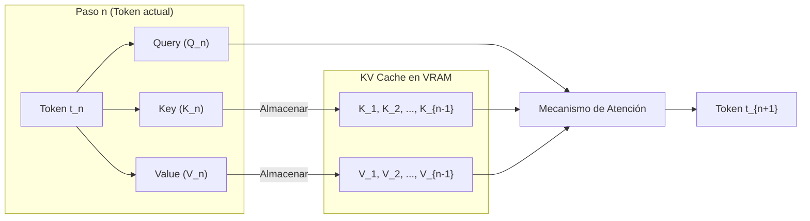

# Memoria en Modelos LLM: Pesos y KV Cache (Familia Qwen 3.5 – 3.8)

Este documento detalla los requerimientos de memoria (VRAM / RAM) para la inferencia de modelos de lenguaje, dividiendo el consumo en dos componentes fundamentales:
1. **Memoria Estática (Pesos del Modelo):** Tamaño fijo según arquitectura y formato de cuantización.
2. **Memoria Dinámica (KV Cache):** Tamaño variable que escala según el tamaño del contexto y el número de conexiones/usuarios concurrentes.

---

## 1. Tabla de Pesos en Memoria (Familia Qwen 3.5 a 3.8)

Los pesos del modelo representan la carga estática que debe residir en VRAM (o RAM de sistema en CPU/Unified Memory) para poder ejecutar la inferencia.

| Modelo | Parámetros (Totales / Activos) | BF16 / FP16 (Original) | FP8 / Q8_0 (Servidor / GGUF) | GGUF Q5_K_M (Equilibrio) | AWQ INT4 (vLLM / SGLang) | INT4 AutoRound / Q4_K_M | NVFP4 (NVIDIA Blackwell) |
| :--- | :--- | :---: | :---: | :---: | :---: | :---: | :---: |
| **Qwen 3.5 - 0.8B** | 0.8B / 0.8B (Dense) | ~1.6 GB | ~0.8 GB | ~0.55 GB | ~0.48 GB | ~0.45 GB | *No optimizado* |
| **Qwen 3.5 - 4B** | 4B / 4B (Dense) | ~8.0 GB | ~4.0 GB | ~2.8 GB | ~2.4 GB | ~2.3 GB | *No optimizado* |
| **Qwen 3.5 - 9B** | 9B / 9B (Dense) | ~18.0 GB | ~9.0 GB | ~6.2 GB | ~5.3 GB | ~5.0 GB | *No optimizado* |
| **Qwen 3.5 - 27B** | 27B / 27B (Dense) | ~54.0 GB | ~27.0 GB | ~18.5 GB | ~15.5 GB | ~15.2 GB | ~14.5 GB |
| **Qwen 3.6 - 27B** | 27B / 27B (Dense) | ~54.0 GB | ~27.0 GB | ~18.5 GB | ~15.5 GB | ~15.2 GB | ~14.5 GB |
| **Qwen 3.8 - 27B MTP/DFlash** | 27B / 27B (Dense + Drafter) | ~53.0 GB | ~28.0 GB | ~19.0 GB | ~21.0 GB | ~21.0 GB | ~22.0 GB |
| **Qwen 3.6 - 35B** | 35B / 3B (MoE) | ~70.0 GB | ~35.0 GB | ~24.0 GB | ~20.2 GB | ~19.8 GB | ~18.5 GB |
| **Qwen 3.5 - 122B** | 122B / 10B (MoE) | ~244.0 GB | ~122.0 GB | ~84.0 GB | ~71.5 GB | ~69.0 GB | ~65.0 GB |
| **Qwen 3.5 - 397B** | 397B / 17B (MoE) | ~794.0 GB | ~397.0 GB | ~273.0 GB | ~231.0 GB | ~223.0 GB | ~210.0 GB |

> **Nota sobre MoE (Mixture of Experts):** En modelos MoE como el 35B (3B activos) o 122B (10B activos), **todos los pesos deben estar cargados en memoria**, pero la velocidad de cómputo por token equivale a un modelo del tamaño de los parámetros activos.

---

## 2. ¿Qué es la KV Cache (Key-Value Cache)?

En la arquitectura Transformer estándar, la generación de texto es **autoregresiva**: para predecir el siguiente token $t_{n+1}$, el modelo debe prestar atención (*self-attention*) a todos los tokens precedentes $t_1, t_2, \dots, t_n$.

### El Problema sin Cache
Sin almacenamiento intermedio, en cada paso de generación sería necesario recomputar las matrices de **Key ($K$)** y **Value ($V$)** de todos los tokens anteriores en todas las capas del modelo. Esto generaría una complejidad temporal cuadrática $O(n^2)$ por token generado, haciendo la inferencia inviablemente lenta.

### La Solución del KV Cache
La **KV Cache** almacena en la memoria VRAM los vectores $K$ y $V$ ya calculados de todas las posiciones previas para cada capa del modelo.
- **Ventaja:** Cada nuevo token solo requiere calcular su propia proyección $Q, K, V$ y multiplicarla por los vectores almacenados, logrando un coste computacional de $O(1)$ por token generado.
- **Desventaja (Consumo de VRAM):** La KV Cache crece de forma estrictamente lineal con la longitud de la conversación (contexto) y se multiplica por cada usuario o conexión concurrente conectada al servidor.

---

## 3. Fórmula Matemática de la KV Cache

La cantidad de memoria requerida para la KV Cache se calcula de forma analítica mediante la siguiente fórmula:

$$\text{KV Cache Size (Bytes)} = 2 \times n_{\text{layers}} \times n_{\text{kv\_heads}} \times d_{\text{head}} \times L_{\text{ctx}} \times B \times \text{bytes\_per\_elem}$$

Donde:
* **$2$**: Factor por almacenar dos tensores independientes: **Key** y **Value**.
* **$n_{\text{layers}}$**: Número total de capas Transformer en el modelo.
* **$n_{\text{kv\_heads}}$**: Número de cabezales de atención dedicados a Key y Value.
  * *Importante:* Gracias a **GQA (Grouped-Query Attention)**, los modelos Qwen modernos utilizan menos cabezales KV que cabezales Query ($n_{\text{kv\_heads}} \ll n_{\text{q\_heads}}$), reduciendo la KV cache drásticamente (típicamente entre un $4\times$ y un $8\times$).
* **$d_{\text{head}}$**: Dimensión de cada cabezal de atención ($d_{\text{head}} = \text{hidden\_size} / n_{\text{q\_heads}}$, habitualmente 128).
* **$L_{\text{ctx}}$**: Longitud de la secuencia / tokens en la ventana de contexto (ej. 4.096, 32.768, 131.072).
* **$B$**: Número de conexiones activas o secuencias concurrentes (*Batch Size*).
* **$\text{bytes\_per\_elem}$**: Precisión del almacenamiento:
  * **FP16 / BF16**: 2 bytes por elemento (estándar).
  * **FP8**: 1 byte por elemento (50% de ahorro).
  * **INT4**: 0.5 bytes por elemento (75% de ahorro).

---

## 4. Consumo de KV Cache por Conexión en Modelos Qwen

A continuación se muestra el consumo de memoria por conexión activa para diferentes longitudes de contexto, comparando **FP16** frente a **FP8**:

### A. Huella por Token (Byte/Token por Conexión)

| Modelo Qwen | Capas ($n_{\text{layers}}$) | KV Heads ($n_{\text{kv}}$) | Head Dim ($d_{\text{head}}$) | Bytes / Token (FP16) | Bytes / Token (FP8) |
| :--- | :---: | :---: | :---: | :---: | :---: |
| **Qwen 3.5 - 0.8B** | 24 | 2 | 64 | **6.14 KB** | **3.07 KB** |
| **Qwen 3.5 - 4B** | 36 | 4 | 128 | **36.86 KB** | **18.43 KB** |
| **Qwen 3.5 - 9B** | 28 | 4 | 128 | **28.67 KB** | **14.34 KB** |
| **Qwen 3.5 / 3.6 - 27B** | 64 | 8 | 128 | **131.07 KB** (~0.128 MB) | **65.54 KB** (~0.064 MB) |
| **Qwen 3.8 - 27B (DeltaNet/Attn)** | 64 | 8 | 128 | **~131.07 KB** | **~65.54 KB** |
| **Qwen 3.6 - 35B (A3B MoE)** | 40 | 4 | 128 | **40.96 KB** (~0.040 MB) | **20.48 KB** (~0.020 MB) |
| **Qwen 3.5 - 122B (A10B MoE)** | 48 | 8 | 128 | **98.30 KB** (~0.096 MB) | **49.15 KB** (~0.048 MB) |
| **Qwen 3.5 - 397B (A17B MoE)** | 64 | 8 | 128 | **131.07 KB** (~0.128 MB) | **65.54 KB** (~0.064 MB) |

---

### B. Consumo Total de KV Cache por Conexión (FP16 vs FP8)

| Modelo Qwen | Contexto 4K (FP16 / FP8) | Contexto 8K (FP16 / FP8) | Contexto 32K (FP16 / FP8) | Contexto 128K (FP16 / FP8) |
| :--- | :---: | :---: | :---: | :---: |
| **Qwen 3.5 - 0.8B** | 24.5 MB / 12.3 MB | 49.1 MB / 24.6 MB | 196.6 MB / 98.3 MB | 786.4 MB / 393.2 MB |
| **Qwen 3.5 - 4B** | 147.5 MB / 73.7 MB | 294.9 MB / 147.5 MB | 1.18 GB / 589.8 MB | 4.72 GB / 2.36 GB |
| **Qwen 3.5 - 9B** | 114.7 MB / 57.3 MB | 229.4 MB / 114.7 MB | 917.5 MB / 458.8 MB | 3.67 GB / 1.84 GB |
| **Qwen 3.5 / 3.6 - 27B** | **524.3 MB / 262.1 MB** | **1.05 GB / 524.3 MB** | **4.19 GB / 2.10 GB** | **16.78 GB / 8.39 GB** |
| **Qwen 3.8 - 27B** | **524.3 MB / 262.1 MB** | **1.05 GB / 524.3 MB** | **4.19 GB / 2.10 GB** | **16.78 GB / 8.39 GB** |
| **Qwen 3.6 - 35B (MoE)** | 163.8 MB / 81.9 MB | 327.7 MB / 163.8 MB | 1.31 GB / 655.4 MB | 5.24 GB / 2.62 GB |
| **Qwen 3.5 - 122B (MoE)** | 393.2 MB / 196.6 MB | 786.4 MB / 393.2 MB | 3.15 GB / 1.57 GB | 12.58 GB / 6.29 GB |
| **Qwen 3.5 - 397B (MoE)** | 524.3 MB / 262.1 MB | 1.05 GB / 524.3 MB | 4.19 GB / 2.10 GB | 16.78 GB / 8.39 GB |

---

## 5. Escenarios Prácticos de Servidor y Concurrencia

### Ejemplo 1: Servidor Local con Qwen 3.5 / 3.6 27B en AWQ INT4 (GPU 24GB RTX 3090/4090)
* **Pesos del modelo (INT4):** ~15.5 GB VRAM
* **VRAM disponible para KV Cache:** $24\text{ GB} - 15.5\text{ GB} - 1.0\text{ GB (CUDA overhead)} = \mathbf{7.5\text{ GB}}$
* **Capacidad de concurrencia:**
  * Con contexto de **4K tokens** en FP16 (524 MB/conn): $\approx \mathbf{14\text{ conexiones concurrentes}}$.
  * Con contexto de **4K tokens** en **FP8 KV Cache** (262 MB/conn): $\approx \mathbf{28\text{ conexiones concurrentes}}$.
  * Con contexto largo de **32K tokens** en FP16 (4.19 GB/conn): $\approx \mathbf{1\text{ conexión activa}}$ (se saturaría con 2).
  * Con contexto largo de **32K tokens** en **FP8 KV Cache** (2.10 GB/conn): $\approx \mathbf{3\text{ conexiones concurrentes}}$.

### Ejemplo 2: Servidor MoE Qwen 3.6 35B (A3B) en AWQ INT4 (1x GPU 24GB)
* **Pesos del modelo (INT4):** ~19.8 GB VRAM
* **VRAM disponible para KV Cache:** $24\text{ GB} - 19.8\text{ GB} - 0.8\text{ GB} = \mathbf{3.4\text{ GB}}$
* **Capacidad de concurrencia:**
  * Al tener solo 4 KV heads ($40.96\text{ KB/token}$), a **8K tokens** (328 MB/conn) permite hasta $\mathbf{10\text{ conexiones concurrentes}}$ simultáneas a pesar de ser un modelo de 35B parámetros totales.

---

## 6. Técnicas Clave de Optimización de la KV Cache

1. **PagedAttention (vLLM / SGLang):**
   * Gestiona la KV Cache en bloques de páginas no contiguas en memoria física, similar a la memoria virtual de los sistemas operativos.
   * Elimina la fragmentación interna y externa de la VRAM, reduciendo el desperdicio de memoria del 60–80% tradicional a menos del 4%.

2. **Cuantización de KV Cache (FP8 / INT4):**
   * Motores modernos como vLLM (`--kv-cache-dtype fp8`) y SGLang permiten almacenar los tensores $K$ y $V$ en 8 bits (FP8) o 4 bits sin degradar la precisión del modelo, duplicando o cuadruplicando la cantidad de usuarios simultáneos.

3. **Prefix Caching / Prompt Caching (RadixAttention en SGLang / vLLM):**
   * Reutiliza automáticamente los bloques de KV Cache ya calculados para system prompts comunes, documentos en sistemas RAG, o historial de turnos anteriores en chats multi-turno, evitando recalcular tokens repetidos.

4. **Modelos Híbridos / MLA (Multi-Head Latent Attention):**
   * Nuevas arquitecturas (DeepSeek V3/R1 y variantes Qwen 3.8 híbridas con DeltaNet) proyectan $K$ y $V$ en un espacio latente comprimido de bajo rango, logrando reducciones del tamaño de la KV Cache de hasta un 80–90% respecto a GQA estándar.

---

## 7. Referencias y Enlaces Oficiales

* **Qwen Official Hub & Docs:** [QwenLM Organization (Hugging Face)](https://huggingface.co/Qwen) | [Qwen GitHub Repository](https://github.com/QwenLM/Qwen2.5)
* **PagedAttention & vLLM Architecture:** [vLLM: Easy, Fast, and Cheap LLM Serving with PagedAttention (Kwon et al., SOSP 2023)](https://arxiv.org/abs/2309.06180) | [vLLM Documentation](https://docs.vllm.ai/)
* **SGLang & RadixAttention:** [Fast and Expressive LLM Serving with SGLang (Zheng et al.)](https://arxiv.org/abs/2312.07104) | [SGLang Documentation](https://sgl-project.github.io/)
* **AutoRound (Intel):** [Advanced Quantization for LLMs with AutoRound](https://github.com/intel/auto-round)
* **Hugging Face Transformers Model Configuration Reference:** [Transformers Attention Mechanisms & Memory Calculation](https://huggingface.co/docs/transformers/main/en/kv_cache)
